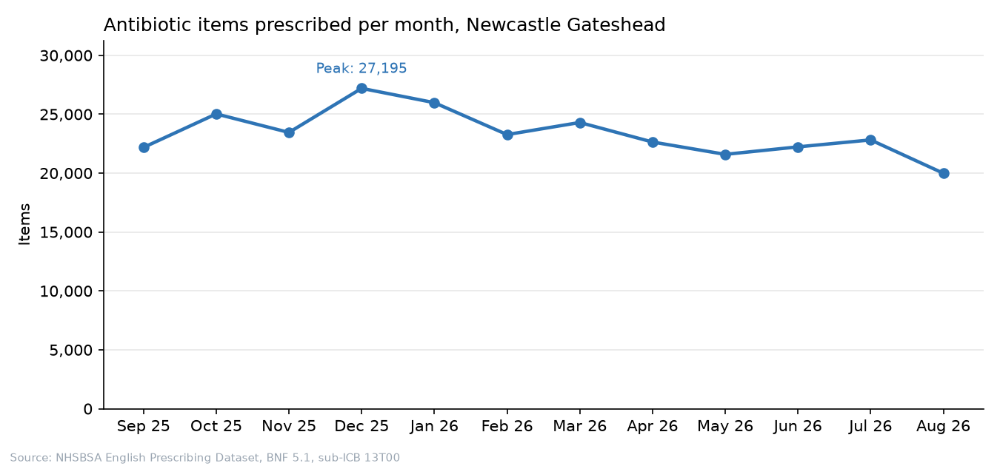
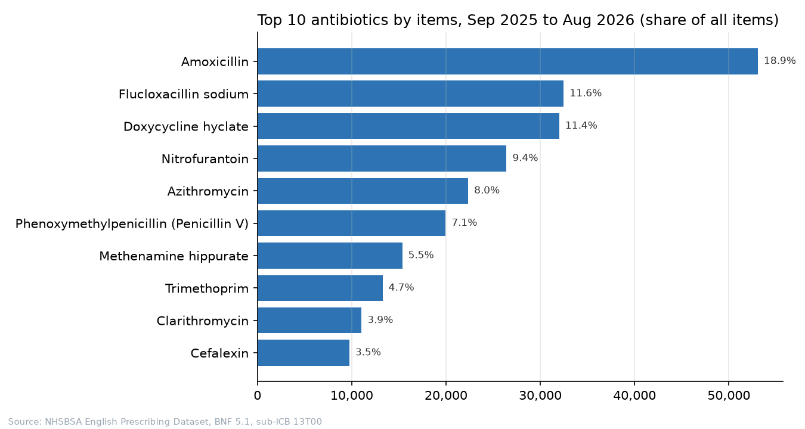
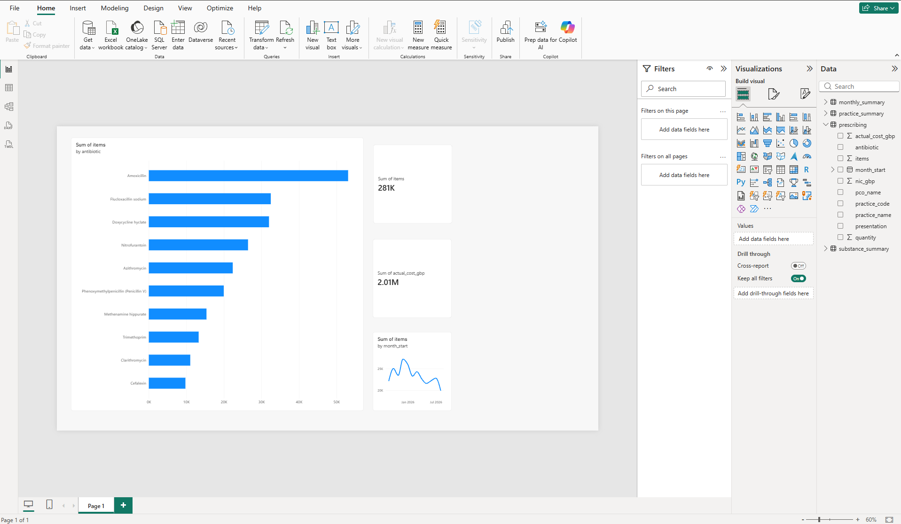

# Trusted Prescribing Pipeline


An end to end data solution on live NHS open data, covering **engineering**,
**testing** and **insight**: from a public API to reconciled, quality-checked
reporting tables and findings a non-technical stakeholder can trust.

**Question:** how are antibiotics prescribed across GP practices in Newcastle
Gateshead, and can every number be traced back to its source?

## Key findings

<!-- findings:start -->
- **280,668 antibiotic items** cost the NHS **GBP 2,013,329** across 12 months (September 2025 to August 2026), from 65,299 prescription lines.
- **Winter peak:** the busiest month was **December 2025** with 27,195 items, 36% more than the quietest, **August 2026** (19,989).
- **Concentration:** three antibiotics, Amoxicillin, Flucloxacillin sodium, Doxycycline hyclate, make up **41.9%** of all items.
- **Data quality:** 11 of 12 checks passed. 1 prescriber (67 lines) uses a non-standard practice code; logged as [OBS-001](docs/defects/OBS-001-non-standard-practice-codes.md) for investigation.
- **Limitation:** the dataset has no patient list sizes, so practices are compared on volume, not on prescribing per patient.
<!-- findings:end -->





Full tables: [`reports/findings.md`](reports/findings.md)

## How it works

```
NHSBSA Open Data API
        |
        v
 BRONZE  raw copy, every column as text, with source file and load time
         bronze.epd_raw, bronze.load_log        <- row counts reconciled to the API
        |
        v
 SILVER  cleaned and typed: dates, whole numbers, money, true/false
         silver.prescribing, silver.dq_results  <- 12 data quality checks
        |
        v
 GOLD    reporting tables: monthly, by antibiotic, by prescriber
         gold.monthly_summary, gold.substance_summary, gold.practice_summary
                                                <- totals reconciled to silver
        |
        v
 REPORT  charts, findings.md, and the Key findings section above
```

| Principle | How it is applied |
|---|---|
| **Metadata driven** | What to load lives in [`config/sources.yml`](config/sources.yml); data quality rules live in [`config/checks.yml`](config/checks.yml). New sources or checks need no Python changes. |
| **Reconciled at every layer** | API count = bronze rows for every month; bronze = silver rows; gold totals = silver totals. A mismatch is a FAIL, never a silent gap. |
| **Flag, never delete** | Values that fail conversion are kept beside their raw text and flagged by a check. |
| **Re-runnable** | Loading a month twice replaces it rather than duplicating it. |
| **Auditable** | Every load and every check result is stored with a timestamp (`bronze.load_log`, `silver.dq_results`). |

## Testing and quality

- **38 automated tests** (`pytest`), run on every push by GitHub Actions. They run offline against a stand-in for the API.
- **12 data quality checks** across completeness, validity, consistency, plausibility and uniqueness.
- **Three-level reconciliation**: source to bronze, bronze to silver, silver to gold.
- **Documented test approach**: [requirements and acceptance criteria](docs/01-requirements.md), [test plan with 16 traced test cases](docs/02-test-plan.md), and defect reports:
  - [DEF-001](docs/defects/DEF-001-wrong-column-name.md): source filter used a column that does not exist (closed)
  - [OBS-001](docs/defects/OBS-001-non-standard-practice-codes.md): prescribers with non-standard practice codes (open)

## Run it

```
python -m venv .venv
.venv\Scripts\Activate.ps1
pip install -r requirements.txt

pytest                         # run the tests
python -m pipeline.discover    # check what the portal holds
python -m pipeline.ingest      # load every configured month into bronze
python -m pipeline.silver      # clean, run quality checks
python -m pipeline.report      # build gold, charts and findings
python -m pipeline.export      # CSV files for Power BI
python -m pipeline.peek        # look inside the warehouse
```

Full Windows setup steps are in [SETUP.md](SETUP.md).

## Project layout

| Path | Purpose |
|---|---|
| `config/sources.yml` | What to load: dataset, months, filter |
| `config/checks.yml` | Data quality checks, one SQL rule each |
| `sql/silver/`, `sql/gold/` | Transformation SQL for each layer |
| `pipeline/api.py` | Client for the NHSBSA Open Data Portal API |
| `pipeline/ingest.py`, `pipeline/bronze.py` | Load, reconcile and log into bronze |
| `pipeline/silver.py` | Build silver and run the quality checks |
| `pipeline/report.py` | Build gold, reconcile, draw charts, write findings |
| `pipeline/export.py` | Export gold tables to CSV for Power BI |
| `powerbi/` | Power BI dashboard (.pbix) and screenshot |
| `pipeline/discover.py`, `pipeline/peek.py` | Explore the source and the warehouse |
| `tests/` | Automated tests |
| `docs/` | Requirements, test plan, defect reports |
| `reports/` | Generated charts and findings |

## Tools

Python, SQL, DuckDB, REST API, JSON, YAML, pytest, matplotlib, Power BI, Git, GitHub Actions.

## Roadmap

- [x] Requirements and acceptance criteria
- [x] Bronze: config driven ingestion with reconciliation and load log
- [x] Silver: typed, cleaned tables with 12 data quality checks
- [x] Gold: reporting tables reconciled to silver
- [x] Test plan, defect reports, CI on every push
- [x] Charts and findings generated from data
- [x] Power BI dashboard on the gold tables: 
- [ ] Resolve OBS-001 against the NHS Organisation Data Service
- [ ] Run the pipeline on a cloud platform (Databricks)

## Data source and licence

English Prescribing Dataset (EPD) with SNOMED code, NHS Business Services
Authority Open Data Portal. Contains public sector information licensed under
the Open Government Licence v3.0. Data is aggregated by prescriber; it contains
no patient-level information.
