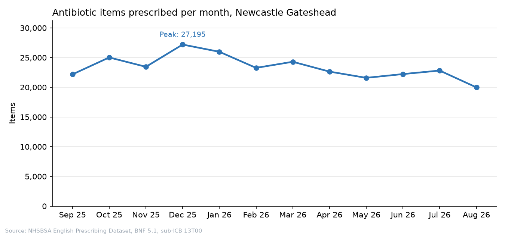
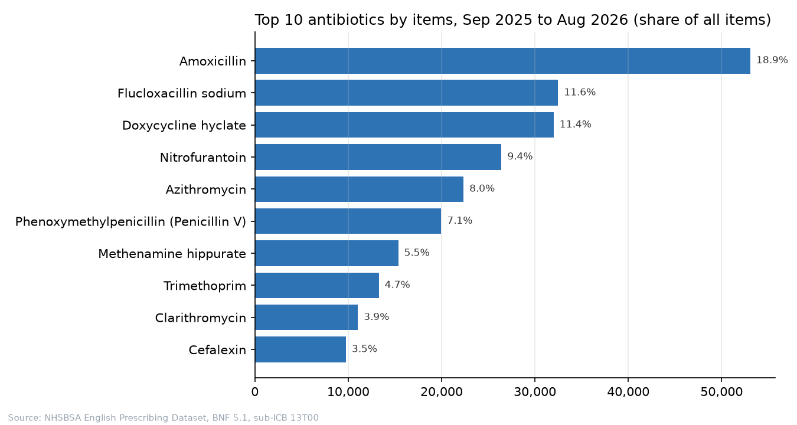

# Findings

Generated by `python -m pipeline.report`. Every number below comes from the gold tables.

## Key findings

- **280,668 antibiotic items** cost the NHS **GBP 2,013,329** across 12 months (September 2025 to August 2026), from 65,299 prescription lines.
- **Winter peak:** the busiest month was **December 2025** with 27,195 items, 36% more than the quietest, **August 2026** (19,989).
- **Concentration:** three antibiotics, Amoxicillin, Flucloxacillin sodium, Doxycycline hyclate, make up **41.9%** of all items.
- **Data quality:** 11 of 12 checks passed. 1 prescriber (67 lines) uses a non-standard practice code; logged as [OBS-001](docs/defects/OBS-001-non-standard-practice-codes.md) for investigation.
- **Limitation:** the dataset has no patient list sizes, so practices are compared on volume, not on prescribing per patient.

## Monthly summary

| Month | Practices | Items | Cost (GBP) | Cost per item (GBP) |
|---|---:|---:|---:|---:|
| Sep 2025 | 66 | 22,181 | 149,464.23 | 6.74 |
| Oct 2025 | 66 | 25,026 | 175,289.91 | 7.00 |
| Nov 2025 | 66 | 23,452 | 159,409.52 | 6.80 |
| Dec 2025 | 66 | 27,195 | 170,475.29 | 6.27 |
| Jan 2026 | 65 | 25,980 | 174,551.82 | 6.72 |
| Feb 2026 | 66 | 23,271 | 155,895.38 | 6.70 |
| Mar 2026 | 66 | 24,297 | 173,953.37 | 7.16 |
| Apr 2026 | 66 | 22,640 | 169,360.75 | 7.48 |
| May 2026 | 66 | 21,592 | 166,481.58 | 7.71 |
| Jun 2026 | 66 | 22,227 | 175,590.49 | 7.90 |
| Jul 2026 | 66 | 22,818 | 179,525.54 | 7.87 |
| Aug 2026 | 66 | 19,989 | 163,330.70 | 8.17 |

## Top 10 antibiotics

| Antibiotic | Items | Share of items | Cost (GBP) | Cost per item (GBP) |
|---|---:|---:|---:|---:|
| Amoxicillin | 53,069 | 18.9% | 53,684.20 | 1.01 |
| Flucloxacillin sodium | 32,480 | 11.6% | 69,452.05 | 2.14 |
| Doxycycline hyclate | 32,003 | 11.4% | 34,608.34 | 1.08 |
| Nitrofurantoin | 26,418 | 9.4% | 170,089.77 | 6.44 |
| Azithromycin | 22,353 | 8.0% | 50,039.85 | 2.24 |
| Phenoxymethylpenicillin (Penicillin V) | 19,957 | 7.1% | 43,953.44 | 2.20 |
| Methenamine hippurate | 15,359 | 5.5% | 175,881.84 | 11.45 |
| Trimethoprim | 13,273 | 4.7% | 57,901.67 | 4.36 |
| Clarithromycin | 11,038 | 3.9% | 50,534.55 | 4.58 |
| Cefalexin | 9,749 | 3.5% | 23,103.18 | 2.37 |

## Prescribers with non-standard practice codes (OBS-001)

| Code | Name | Months active | Items |
|---|---|---:|---:|
| 13T998 | UNIDENTIFIED DOCTORS | 12 | 97 |
